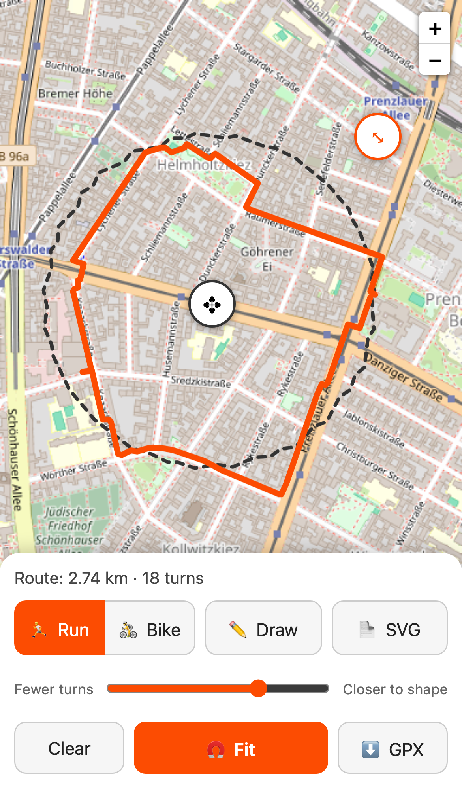
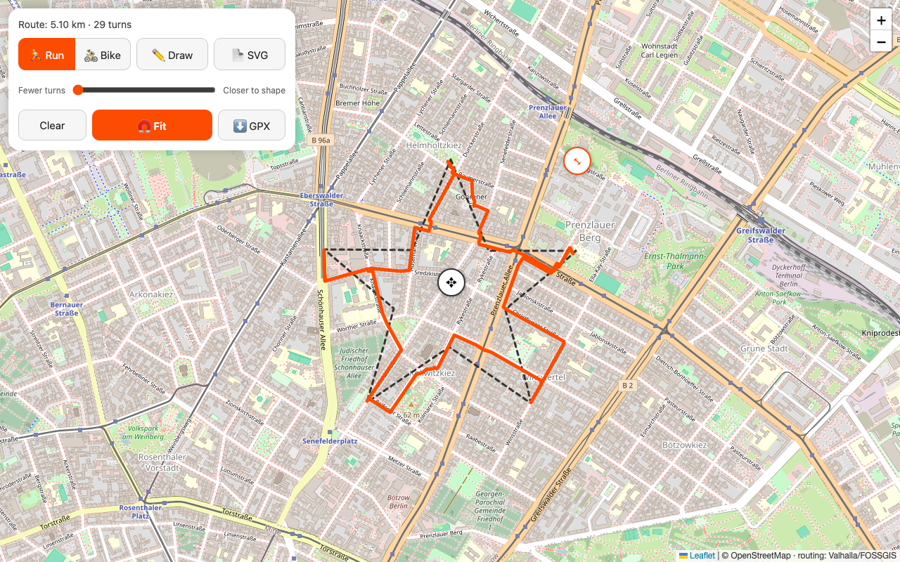

# routeGPX

Turn any city into a canvas. Sketch a shape on an OpenStreetMap map (or upload an SVG), snap it to real running or cycling paths, and export a GPX you can follow on your watch or Garmin.

<p>
  
  
</p>

## Features

- **Run / Bike** – routes on walking paths or bike-friendly streets (prefers cycle lanes over roads).
- **Draw** – freehand with mouse, finger or pen.
- **Upload SVG** – any paths/shapes in the file are traced and placed in the middle of the current view.
- **Move, scale, rotate** – drag ✥ to move the shape, ⤡ to scale and rotate it. Lining the shape up with the street grid gives cleaner routes.
- **Fit** – snaps the shape to the street network on demand.
- **Fewer turns ↔ Closer to shape** – a slider that trades shape fidelity for a simpler route. The status line shows distance and turn count.
- **Export GPX** – a standard GPX 1.1 track; Garmin Connect, Strava, Komoot etc. import it as a course/route.
- Mobile first: bottom sheet controls on phones, floating card on desktop.

## How the snapping works

1. The sketch is simplified (Douglas–Peucker) to remove hand jitter, keeping its corners.
2. Waypoints are placed on those corners plus evenly along long sides (spacing set by the slider, 150–800 m).
3. The waypoints are routed with [Valhalla](https://github.com/valhalla/valhalla) (`pedestrian` or `bicycle` costing) on the free FOSSGIS server, in chunks of 10 locations.
4. Out-and-back detours (dead ends, waypoint snapped to the far sidewalk) are cut from the result — unless they reach a sharp corner of your shape, like the tip of a star.

Map-matching the raw sketch (`trace_route`) was tried first and dropped: on freehand shapes it fragments into disconnected pieces and zig-zags.

## Run it

Requires Node 22+ and pnpm.

```sh
pnpm install
pnpm dev      # http://localhost:5173
pnpm test     # self-check of the geometry helpers
pnpm build    # static site in dist/
```

The build is a static site — host `dist/` anywhere (GitHub Pages, Netlify, …).

## Code

- `src/App.tsx` – map (Leaflet), drawing, SVG import, move/scale handles, UI.
- `src/route.ts` – geometry (resample, simplify, transform, spur removal), Valhalla routing, GPX export.
- `src/route.check.ts` – assert-based self-check.

## Limits

- Uses the public Valhalla server at `valhalla1.openstreetmap.de` (fair use ≈ 1 request/s, 10 locations per request), so long shapes take a few seconds. For heavy use, run your own Valhalla and change `VALHALLA` in `src/route.ts`.
- The route follows the shape approximately; rivers, railways and parks force detours.

## Credits

Map data © [OpenStreetMap](https://www.openstreetmap.org/copyright) contributors. Routing by Valhalla, hosted by [FOSSGIS](https://www.fossgis.de/).
